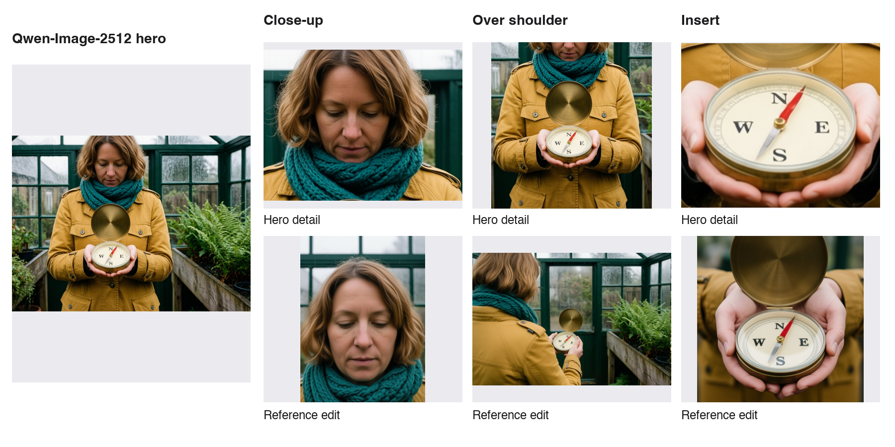

# Shot Board

<picture><source media="(prefers-color-scheme: dark)" srcset="docs/logo-dark.svg"></picture>

Shot Board turns one line of scene into a six-shot coverage storyboard. You choose one hero frame, and it redraws the other cuts from that frame.

Categories: Best Overall and Open Weights Only. Both models, SDXL Base 1.0 and Qwen-Image-Edit-2511, are open weights and run on your own ComfyUI.


## Try it without a GPU

The [live demo](https://arcsolver.github.io/shot-board/) opens the three boards in the repo. To run them on your machine you need Git and uv:

```sh
git clone --depth 1 https://github.com/ArcSolver/shot-board.git shot-board
cd shot-board
uv venv .venv --python 3.12
uv pip install --python .venv/bin/python -r requirements.lock.txt --require-hashes
.venv/bin/python -m uvicorn shotboard.server:app --host 127.0.0.1 --port 8790
```

Open **http://127.0.0.1:8790** and choose **Open this board**.

## What it does

You write one scene and Shot Board lays out six editable cuts: establishing, medium, face close-up, over shoulder, insert and low angle. A scene without a person gets a detail close-up and a side angle in place of the face and shoulder shots. You can add up to three more cuts, give the scene character, prop and setting details, and edit each cut's prompt.

SDXL renders the first takes. In **Compare & pick** you see each take beside the hero, pick one per cut, lock a seed, and save a pass or fail verdict with a note. The hero is an SDXL take or an image you import. **Render reference edits** then sends every other cut to Qwen-Image-Edit-2511 with the hero as the reference.



When every cut has a pick, export a landscape or portrait storyboard and a ZIP with the stills, ComfyUI workflows and manifest.

| Home | Board | Compare & pick | Storyboard |
|---|---|---|---|
|  |  |  |  |

## How it works

The app (FastAPI, on the CPU) sends every render request and reference upload through the Comfy SDK to comfy-api-proxy, which runs on loopback in front of your ComfyUI on the GPU worker.

- SDXL Base 1.0 renders the first takes. Pinned in [model-lock.json](workflows/model-lock.json); graph in [sdxl-base.api.json](workflows/sdxl-base.api.json).
- Qwen-Image-Edit-2511 makes the reference edits through ComfyUI-GGUF. Pinned in [qwen-model-lock.json](workflows/qwen-model-lock.json) (Q8_0) and [qwen-model-lock-q4_k_m.json](workflows/qwen-model-lock-q4_k_m.json); graph in [qwen-reference.api.json](workflows/qwen-reference.api.json).

## Run it locally

Set up the GPU worker with [docs/SETUP.md](docs/SETUP.md), then start the app:

```sh
uv venv .venv --python 3.12
uv pip install --python .venv/bin/python -r requirements.lock.txt --require-hashes
# Forward local 18188 -> worker 8188 and local 18189 -> worker 8189 over SSH.
COMFY_BASE_URL=http://127.0.0.1:18189 \
COMFY_ENGINE_URL=http://127.0.0.1:18188 \
SHOTBOARD_ENGINE_MANIFEST=/path/to/engine-models.json \
.venv/bin/python -m uvicorn shotboard.server:app --host 127.0.0.1 --port 8790
```

Open **http://127.0.0.1:8790**, choose **New scene**, type a scene and choose **Build shot list**, then **Render board**. In **Compare & pick**, pick an SDXL take, or choose **Import reference** to add your own PNG, JPEG or WebP and pick that. Choose **Use pick as hero**, then **Render reference edits**. Imported stills carry the label **Imported reference**, and the export records their source image and size.

### Reuse a recipe outside the app

Each generated frame's `workflows/sNN.api.json` in the export ZIP is a ComfyUI API-format graph with the cut's prompt, seed and settings filled in. Qwen graphs load the hero from `references/<sha256>.png`, so copy the ZIP's `references` folder into ComfyUI's input directory before you queue one. They need the same pinned model files and ComfyUI-GGUF.

## Boards in the repo

- [The greenhouse](examples/greenhouse-continuity/README.md): "A traveler discovers a small brass compass in a rain-soaked greenhouse." An imported hero and five Qwen reference edits from it, with saved reviews.
- [The greenhouse, first takes](examples/greenhouse/README.md): the same scene, SDXL only.
- [The hangar](examples/hangar/README.md): "A gray utility robot with a square metal head, a single blue optical sensor and mechanical gripper arms repairs a small spaceship engine on a workbench in a quiet hangar at night." SDXL only.

## License and third-party notices

Shot Board source is [MIT](LICENSE).

SDXL Base 1.0 is licensed under CreativeML Open RAIL++-M. The Qwen diffusion model, encoder, vision projector and VAE are Apache-2.0. ComfyUI is GPL-3.0. ComfyUI-GGUF is Apache-2.0. Comfy SDK and comfy-api-proxy are MIT. See [THIRD_PARTY_NOTICES.md](THIRD_PARTY_NOTICES.md) and [workflows/](workflows/).
