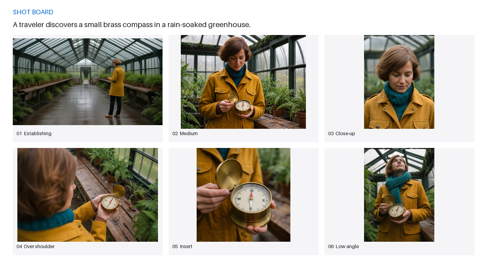
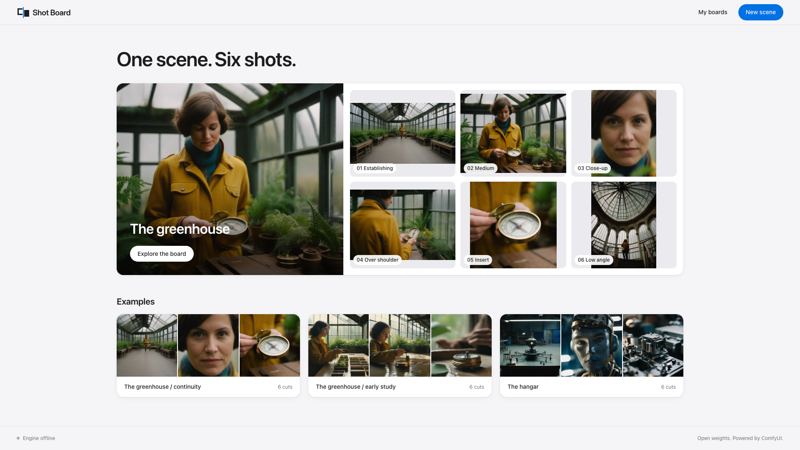
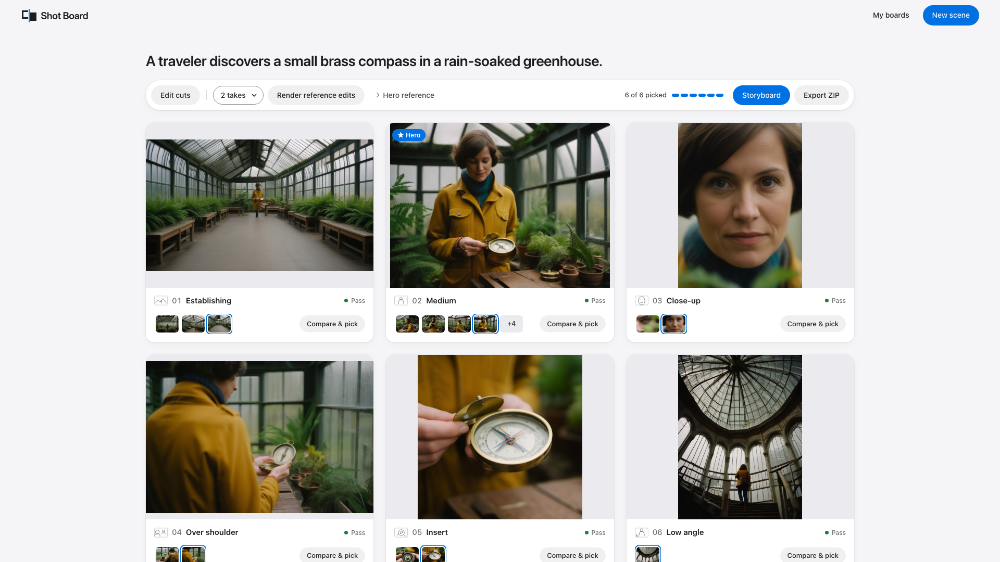
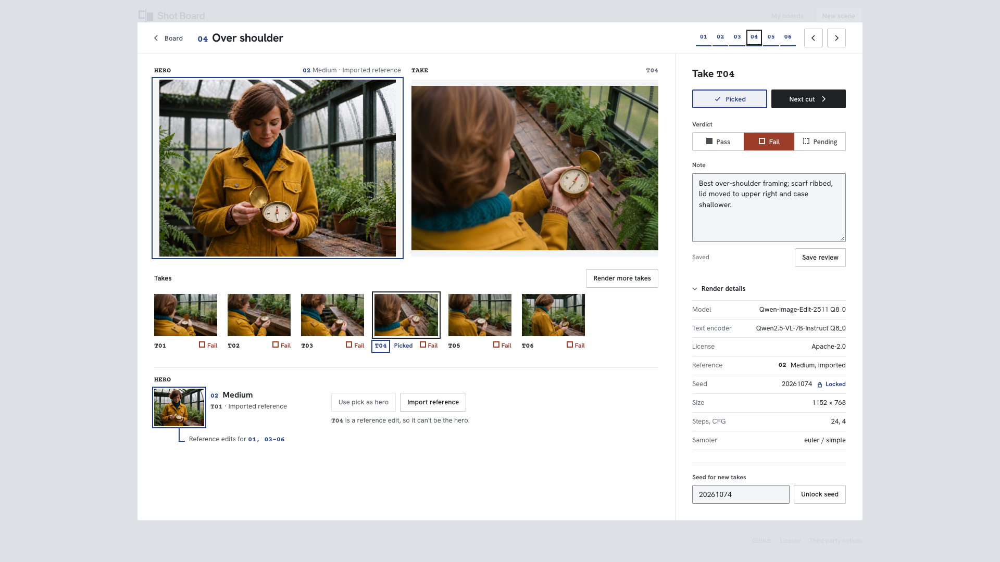
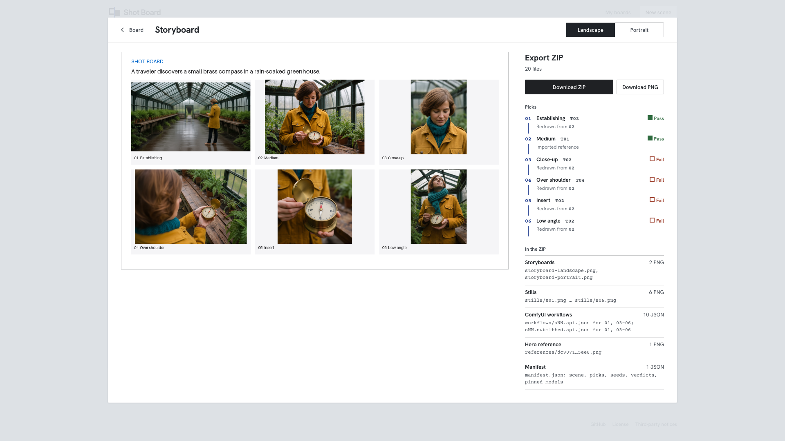

# Shot Board

<picture><source media="(prefers-color-scheme: dark)" srcset="docs/logo-dark.svg"></picture>

**A storyboard app for film coverage: one scene, six shots.**



## Try it without a GPU

Browse, review and export the three boards that ship with the repo. You need Git and uv.

```sh
git clone --depth 1 https://github.com/ArcSolver/shot-board.git shot-board
cd shot-board
uv venv .venv --python 3.12
uv pip install --python .venv/bin/python -r requirements.lock.txt --require-hashes
.venv/bin/python -m uvicorn shotboard.server:app --host 127.0.0.1 --port 8790
```

Open **http://127.0.0.1:8790** and choose **Explore the board**, or open another board from the home page. To render new takes, see [Run it locally](#run-it-locally).

## What it does

You write one scene and Shot Board lays out six editable cuts from a coverage template: establishing, medium, face close-up, over shoulder, insert and low angle. When the scene has no person, the face close-up and over shoulder become a detail close-up and a side angle. You can add up to three more, give it character, prop and setting details, and edit each cut's prompt and negative prompt.

SDXL renders takes for each cut. Compare & pick shows every take of a cut side by side with its render details one click away, and you can lock a seed and reuse it. Make one SDXL take the hero and Qwen-Image-Edit-2511 re-renders every other cut from that image. You can save a pass, fail or pending verdict and a note on any take.

When every cut has a pick, export a landscape or portrait storyboard, plus the stills, ComfyUI workflows and saved recipes.

| Home | Board | Compare & pick | Storyboard |
|---|---|---|---|
|  |  |  |  |

## How it works

```text
Browser ──▶ Shot Board (FastAPI, CPU)
              │  Comfy SDK
              ▼
            comfy-api-proxy
              ▼
            ComfyUI (GPU worker)
              ├─ SDXL Base 1.0            → first takes and the hero
              └─ Qwen-Image-Edit-2511     → reference edits from the hero
```

All inference requests and reference uploads go through the Comfy SDK and a loopback proxy to your own ComfyUI.

- **SDXL Base 1.0** renders the first takes. Pinned in [model-lock.json](workflows/model-lock.json); graph in [sdxl-base.api.json](workflows/sdxl-base.api.json).
- **Qwen-Image-Edit-2511** handles reference edits through ComfyUI-GGUF. Pinned in [qwen-model-lock.json](workflows/qwen-model-lock.json) (Q8_0) and [qwen-model-lock-q4_k_m.json](workflows/qwen-model-lock-q4_k_m.json); graph in [qwen-reference.api.json](workflows/qwen-reference.api.json).

On one RTX 4090 (24 GB) an SDXL take took about 4 s and a Q8_0 Qwen edit 80 to 100 s per cut. `SHOTBOARD_QWEN_QUANT=Q4_K_M` cuts the Qwen files from about 31 GB to 20 GB, and a take that loses the engine is retried once.

## Run it locally

See [docs/SETUP.md](docs/SETUP.md) for local setup.

```sh
uv venv .venv --python 3.12
uv pip install --python .venv/bin/python -r requirements.lock.txt --require-hashes
# Forward local 18188 -> worker 8188 and local 18189 -> worker 8189 over SSH.
COMFY_BASE_URL=http://127.0.0.1:18189 \
COMFY_ENGINE_URL=http://127.0.0.1:18188 \
SHOTBOARD_ENGINE_MANIFEST=/path/to/engine-models.json \
.venv/bin/python -m uvicorn shotboard.server:app --host 127.0.0.1 --port 8790
```

Open **http://127.0.0.1:8790** and choose **New scene**. Type a scene or press **Use example**, then build the shot list and render SDXL takes. In **Compare & pick**, pick an SDXL take, open **Seed, hero & more takes** and choose **Use selected as hero**, then **Render reference edits**. Compare the takes, save a verdict on each, and pick.

### Reuse a recipe outside the app

Each `workflows/sNN.api.json` in an export ZIP is a ComfyUI API-format graph with the cut's prompt, seed and settings filled in. Qwen graphs load the hero from `references/<sha256>.png`, so copy the ZIP's `references` folder into ComfyUI's input directory before you queue one. You need the same pinned model files and ComfyUI-GGUF.

## Boards in the repo

Explore the greenhouse and hangar boards, with saved takes, reviews and recipes.

- [Greenhouse continuity](examples/greenhouse-continuity/README.md): "A traveler discovers a small brass compass in a rain-soaked greenhouse." An SDXL hero with Qwen reference edits, both storyboards, the export ZIP and a review of every take.
- [Greenhouse study](examples/greenhouse/README.md): the same scene with the first SDXL-only recipe.
- [Hangar](examples/hangar/README.md): "A gray utility robot with a square metal head, a single blue optical sensor and mechanical gripper arms repairs a small spaceship engine on a workbench in a quiet hangar at night."

## License and third-party notices

Shot Board source is [MIT](LICENSE).

SDXL Base 1.0 is licensed under CreativeML Open RAIL++-M. The Qwen diffusion model, encoder, vision projector and VAE are Apache-2.0. ComfyUI is GPL-3.0. ComfyUI-GGUF is Apache-2.0. Comfy SDK and comfy-api-proxy are MIT. See [THIRD_PARTY_NOTICES.md](THIRD_PARTY_NOTICES.md) and [workflows/](workflows/).

