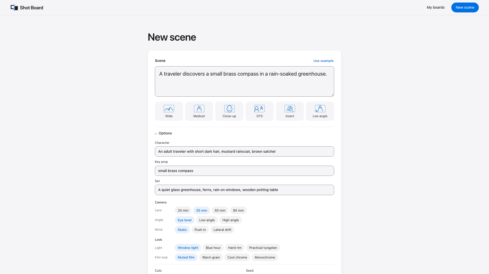

# Shot Board

**A scene, seen six ways.** A local creative workspace for planning cinematic stills with open weights and ComfyUI.

Write a scene. Set your lens, angle, movement intent, lighting and film look. Build an editable six-to-nine-cut shot list, render takes, compare them side by side, and export your selects with the exact ComfyUI graphs and settings that made them.



<!-- Screenshot slot: add a short recorded walkthrough here. -->

## What works

- Deterministic coverage: establishing, medium, close-up, over shoulder, insert, low angle, and three optional cuts. No language model or prompt API.
- Shared character/set bible, shared seed families, editable prompts and negative prompts.
- Serial local rendering, persistent boards, honest queue/status/elapsed time, stop queue and explicit retry by rendering more takes.
- Side-by-side take comparison, one pick per shot, editable reusable seed and seed lock/unlock.
- Export ZIP: selected PNG stills, API-format workflow JSON per cut, and `manifest.json` with checkpoint SHA-256, embedded model components, prompts, sampler settings, dimensions, seeds and output hashes.
- All inference goes through **Comfy SDK 0.5.0 → comfy-api-proxy 0.1.6 → local ComfyUI**. No partner nodes, paid APIs or cloud credentials.

Continuity v1 is guidance, not an identity lock: SDXL can change faces, clothing, props and set geometry. Camera mm/angle chips are text conditioning, not calibrated cameras. Movement chips describe the composition of a still, not video or physical camera movement.

**Reframe is a visible experimental stub.** It queues no generation and returns `enabled: false`. Reference editing with Qwen and a FLUX.2 klein 4B preset are planned, disabled capabilities.

## Run locally, step by step

Requirements: Python 3.12, an existing working ComfyUI installation, roughly 7 GB for SDXL plus output space, and a supported local GPU. The example was rendered with MPS on Apple Silicon. CPU inference is possible but slow. Keep the servers bound to loopback.

### 1. Install the app

From this repository directory:

```sh
python3.12 -m venv .venv
.venv/bin/python -m pip install -r requirements.txt
```

Or with uv:

```sh
uv venv .venv --python 3.12
uv pip install --python .venv/bin/python -r requirements.lock.txt --require-hashes
```

The existing-workspace alternative uses a separate environment and leaves the ComfyUI environment unchanged. From the parent workspace:

```sh
uv venv local/shotboard-venv --python local/venv/bin/python
uv pip install --python local/shotboard-venv/bin/python -r app/requirements.txt
cd app
```

In the commands below, substitute `../local/shotboard-venv/bin/python` for `.venv/bin/python` when using that environment.

### 2. Download the model

Read the [SDXL license](https://huggingface.co/stabilityai/stable-diffusion-xl-base-1.0/blob/main/LICENSE.md), including its use restrictions, before using the model. Using this app with SDXL requires compliance with those restrictions. No account or access token is needed for this public download.

```sh
.venv/bin/python scripts/download_model.py
```

This downloads only `sd_xl_base_1.0.safetensors` (about 6.94 GB) into `.runtime/models/checkpoints/`, verifies its published SHA-256, and writes `workflows/model-lock.json`. The lock records the exact downloaded revision. The checkpoint includes its text encoders and VAE; no refiner, LoRA or extra weight file is needed. Weight files are excluded from git.

If the exact checkpoint already exists, use its checkpoint directory instead of downloading another copy:

```sh
export SHOTBOARD_MODEL_DIR="$COMFYUI_CHECKPOINT_DIR"
```

The app hashes that file before accepting generation and compares it with the lock. Your ComfyUI must load the **same file**, under the filename in the lock; the supplied launcher uses `.runtime/models/checkpoints/` by default. To reuse an existing file with that launcher, symlink it into that directory. Do not substitute a different model with the same filename.

### 3. Start your local engine and SDK proxy

The launcher reuses your installed ComfyUI without changing its source, installed weights or configuration. It writes its own private runtime directories. It stops only its own child processes on Ctrl-C and refuses to claim occupied ports.

```sh
export COMFYUI_DIR="../vendor/ComfyUI"
export COMFYUI_PYTHON="../local/venv/bin/python"
.venv/bin/python scripts/stack.py
```

For a standalone checkout, set those two variables to your own installation. ComfyUI must already have its dependencies installed. The launcher prints `READY` when both ports respond. It uses `--offline --disable-partner-nodes`, disables previews, and on macOS also applies a loopback-only network sandbox. Neither ComfyUI nor its models are bundled or installed by this app.

If your existing stack already serves ComfyUI on port 8188 and the local API proxy on port 8189, reuse it and skip the launcher. Make sure it can see the pinned SDXL checkpoint. The app itself needs the checkpoint file locally to verify its hash.

### 4. Start Shot Board in a second terminal

From the app repository:

```sh
COMFY_BASE_URL=http://127.0.0.1:8189 .venv/bin/python -m uvicorn shotboard.server:app --host 127.0.0.1 --port 8790
```

Open **http://127.0.0.1:8790**. Build a shot list, review/edit each cut, then choose the takes per cut and click **Render board**. You can close the browser while the local server keeps working. Boards persist in `.runtime/boards/` and reopen through **Open a board**.

Rendering takes real time. The UI reports completed takes, queue length, engine state and measured elapsed seconds. It does not invent a sampling percentage. Initial model loading and other host activity affect latency; see the [measured example](examples/greenhouse/README.md).

Click **Compare & pick** on each cut, pick a take, then optionally **Lock seed**. New takes reuse a locked seed exactly; to get a variation with the same seed, edit the prompt before rendering again. Unlocking returns to the board's deterministic seed family sequence. A matching seed alone does not guarantee matching identity or byte-identical results across devices or software versions.

After all cuts have picks, use **Export selects**. Ctrl-C the app and the launcher in their terminals when finished. A server restart marks unfinished takes as interrupted instead of silently resubmitting them. If the app was forcibly killed, inspect the ComfyUI queue before retrying an interrupted take.

### 5. Open the included example

The repository includes a real six-cut, two-take SDXL board and export, with all 12 PNGs and workflows. To view it in the UI without rendering again, stop the app, then:

```sh
.venv/bin/python scripts/import_example.py
COMFY_BASE_URL=http://127.0.0.1:8189 .venv/bin/python -m uvicorn shotboard.server:app --host 127.0.0.1 --port 8790
```

Use **Open a board**. Browsing, comparing, changing picks and exporting the example work without the generation engine running.

## Tests

```sh
.venv/bin/python -m unittest discover -s tests -v
```

Tests cover coverage determinism and limits, chip conditioning, seed zero/reuse, complete ZIP contents and hashes, immutable take provenance after edits, incomplete picks, image tampering, persistence/restart, API validation, same-origin protection and the non-generating Reframe route. They do not run diffusion.

Optional browser verification uses Playwright (`pip install playwright` and `playwright install chromium`). Screenshots in [docs/screenshots](docs/screenshots/) show real app states; no image generation is needed to view them.

## Architecture and extension points

```text
Browser (HTML / CSS / JavaScript)
    │ same-origin local JSON API, polling
FastAPI + disk-backed boards + one render worker
    │ Comfy SDK: workflow → submit → refresh → get_outputs
Local comfy-api-proxy :8189
    │
Separate ComfyUI process :8188 / native SDXL nodes / local weights
```

`shotboard/core.py` owns coverage, preset configuration, seed families, workflow construction and ZIP export. `shotboard/server.py` snapshots each take before queueing, saves state atomically and downloads results through the SDK. Export always reads the take's original workflow/settings, even after the shot prompt changes. Public PNGs omit engine metadata. Model hashes cover the checkpoint and its embedded UNet, CLIP-L, OpenCLIP bigG and VAE.

Add a model by defining an enabled preset, a corresponding workflow builder and its model-file/hash requirements; preserve the SDK-only submission boundary. The disabled `qwen-reference` capability is the future reference-image adapter: upload a picked cut with `client.assets.from_file`, bind it to a reference-edit graph, then reuse the normal take queue/provenance/export path. Qwen is not loaded or used in this version.

`POST /api/boards/{board}/shots/{shot}/reframe` currently returns a non-generating experimental response. A future close-up/small-parallax module can consume a picked still, produce depth/mesh → target-camera render → uncertainty mask → optional local inpaint, then enter the same take/compare/export contract. Record geometry model hashes, camera transforms, masks and provenance separately. Large camera changes are outside the current promise; unseen surfaces are not recoverable by pixel locking alone. Research-only depth weights must not become a product dependency.

This is a single-user local MVP: one server process/worker, no authentication, no multi-user hosting, no automatic resume or hardware-independent reproducibility guarantee. Run uvicorn without `--workers` or `--reload` during generation. Current caps are four takes per request, sixteen per cut and a thirty-minute engine timeout per take.

## Model downloads and licensing

| Model | Download | License | Runtime use |
|---|---|---|---|
| SDXL Base 1.0, `sd_xl_base_1.0.safetensors` | [Public model repository](https://huggingface.co/stabilityai/stable-diffusion-xl-base-1.0/tree/main) | CreativeML Open RAIL++-M, use restrictions apply | Required; embedded encoders and VAE |
| Qwen-Image-Edit-2511 | [Model card](https://huggingface.co/Qwen/Qwen-Image-Edit-2511) | Apache-2.0 | Planned only; do not download for A1 |
| FLUX.2 klein **4B** | [Model card](https://huggingface.co/black-forest-labs/FLUX.2-klein-4B) | Apache-2.0 | Planned only; do not download for A1 |

App source is [MIT](LICENSE). ComfyUI is GPL-3.0 and runs as a separate, unmodified process over HTTP; it is not relicensed by this app. Models retain their own licenses. See [THIRD_PARTY_NOTICES.md](THIRD_PARTY_NOTICES.md) for runtime libraries and model components. No ComfyUI code or model weights are redistributed here.
