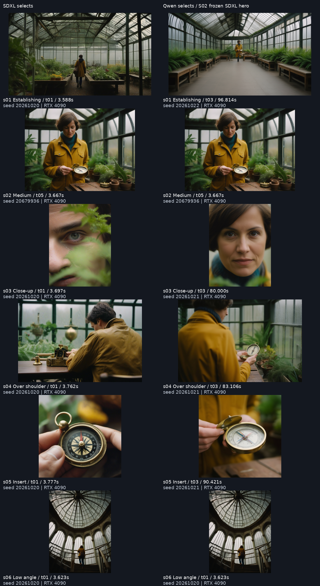

# Greenhouse: SDXL versus hero continuity

Actual renders on one NVIDIA GeForce RTX 4090 through Comfy SDK 0.5.0 and an SSH-tunneled proxy. Scene and seed are the same across methods: an adult traveler finds a brass compass in a rainy greenhouse; seed 20261020. S02/T01 is the frozen SDXL hero. It is reused, never counted as a Qwen render. All nine Qwen attempts reference this same original hero directly.

The workflow is complete; visual preservation is partial. SDXL changes the face. Qwen better retains the visible woman, dark bob and yellow raincoat, and the OTS contains a person. It still changes prop details and invents the wide set. The hero itself misses the requested waist-up medium.

Four targeted prompt retries were made over S01, S03 and S05 using the app's cut editor, with the same seed and hero. Initial Qwen framing passed 2/6 cuts including the reused hero; final framing passes 5/6. This is not an automatic six-cut quality pass. Long scene/action prompts can override framing. The portable recipes preserve the exact shorter instructions used by the selected retries, while each original take keeps its earlier prompt.

PASS means a visible feature is compatible with the hero under human visual review. FAIL means an observed mismatch. FAIL† means it is hidden, too small or too defocused to verify; it is not a claim that identity changed. PASS* is the baseline hero itself. Expected close-ups/inserts naturally hide other attributes, so these columns must not be summed into a success rate. Face judgments are not biometric verification; set judgments concern visible motifs, not calibrated 3D geometry.

## SDXL only

| Cut / take | Person | Outfit | Prop | Set | Shot type |
|---|---|---|---|---|---|
| S01 / t01 | FAIL† | PASS | FAIL† | FAIL† | PASS |
| S02 / t01 | PASS* | PASS | PASS | PASS | FAIL |
| S03 / t01 | FAIL | FAIL† | FAIL† | FAIL† | PASS |
| S04 / t01 | FAIL | FAIL | FAIL | PASS | PASS |
| S05 / t01 | FAIL† | FAIL† | FAIL | FAIL† | PASS |
| S06 / t01 | FAIL† | PASS | FAIL† | FAIL | PASS |

## Continuity selects

| Cut / take | Person | Outfit | Prop | Set | Shot type |
|---|---|---|---|---|---|
| S01 / t03 | FAIL† | PASS | FAIL† | FAIL | PASS |
| S02 / t01 | PASS* | PASS | PASS | PASS | FAIL |
| S03 / t03 | PASS | FAIL† | FAIL† | FAIL† | PASS |
| S04 / t02 | FAIL† | PASS | FAIL | PASS | PASS |
| S05 / t04 | FAIL† | FAIL† | FAIL | FAIL† | PASS |
| S06 / t02 | PASS | PASS | FAIL† | PASS | PASS |

S01 changes to a new huge arched greenhouse. S03 matches the apparent face but hides clothing/prop/set. S04 keeps the bob and yellow hood but uses the right foreground instead of the requested left, and the compass looks like a different hinged-lid object. S05 achieves hands-and-compass macro but changes the dial to green arrows. S06 keeps the apparent woman and upward view; the reverse of the compass cannot verify its dial. The hero is too tightly cropped for a medium.

## Measured seconds per cut

| Cut | SDXL SDK seconds | Continuity SDK seconds | Selected take |
|---|---:|---:|---|
| S01 Establishing | 16.367 | 85.862 | t03 |
| S02 Medium | 4.528 | 0 new; hero reuse (original 4.528) | t01 |
| S03 Close-up | 4.509 | 88.971 | t03 |
| S04 Over shoulder | 4.568 | 101.361 | t02 |
| S05 Insert | 4.584 | 95.815 | t04 |
| S06 Low angle | 4.459 | 85.911 | t02 |

SDXL six-cut sum: 39.015s. All nine Qwen attempts: 864.190s, mean 96.021s, range 85.862–106.775s. See [all attempt timings](timing.csv). Times include model unloading/loading, SDK upload, encoding, sampling, polling, download and metadata stripping; they exclude queue wait, setup and preflight hashing. Cache reuse and model residency vary. These are one-run observations, not a latency guarantee.

Qwen: Edit-2511 Q8_0 + VL-7B Q8_0 + F16 projector + Qwen VAE, 24 steps, CFG 4, Euler/simple, shift 3.1, denoise 1, 1MP reference scaling, no LoRA. Both methods use the same per-cut dimensions, pinned components and immutable snapshots.

## Contents

- `board.json`, `takes/`, `workflows/`, `references/`: all 15 takes, including discarded attempts, exact recipes and the frozen hero.
- `sdxl-board.json`, `sdxl-selects.zip`: the original six SDXL selects before reference editing.
- `selects.zip`, `export/`: the six final picks, hero PNG, portable and submitted graphs, hashes and manifest.
- [All nine Qwen runs](all-qwen-runs.png), [first versus selected attempts](qwen-attempts.png), [historical A1 versus A2 SDXL](before-after-sheet.png). A1 was generated on another backend with different settings; the historical sheet is not a controlled template-only comparison.
- `sdxl-review.json`, `continuity-review.json`, `first-qwen-review.json`: per-cut observations, including failures.
- `provenance.json`, `timing.csv`: engine revisions, flags and actual times.

Import with `python scripts/import_example.py --example greenhouse-a2`. Browsing, comparison and export work without the engine. Next: A3 result-first UI and storyboard export, with these visual limitations kept visible.
