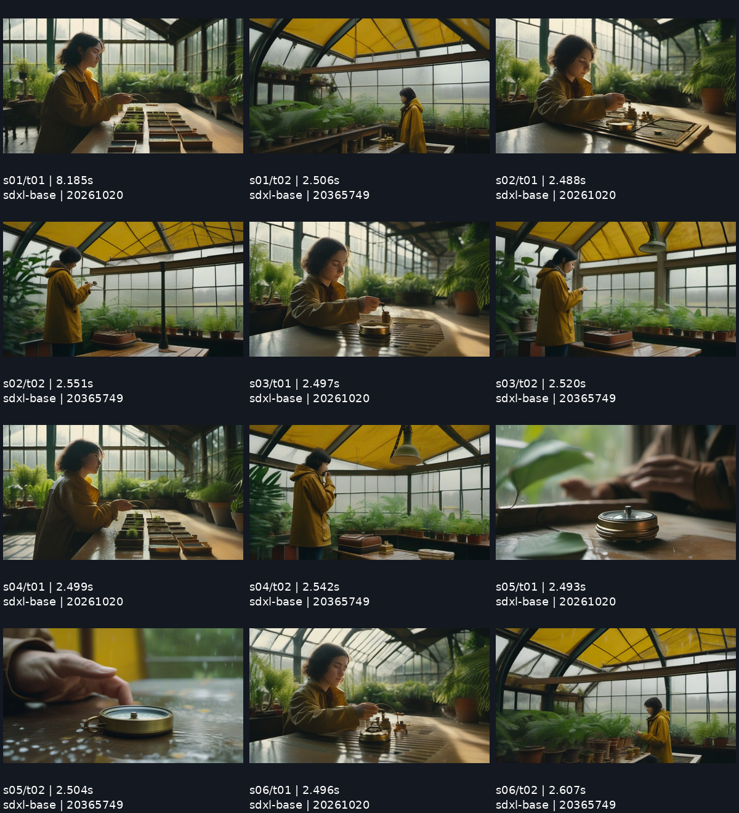

# The greenhouse / a six-cut local example

Scene: **A traveler discovers a small brass compass in a rain-soaked greenhouse.**

This is a synthetic SFW scene rendered from text with SDXL Base 1.0. No photographs, real-person references, existing characters, brand assets or logos were supplied. Twelve actual outputs are included, including the unpicked takes. They have not been retouched; the app strips embedded engine metadata when saving public PNGs.

- 6 cuts × 2 takes, 1024 × 576, 20 steps, CFG 6, Euler / normal, denoise 1.
- Seed families: **20261020** and **20365749**, shared across all six cuts.
- First take picked for each cut; the first cut's seed is locked.
- Measured on Apple Silicon / MPS: **17.226–24.402 seconds per take**, **238.550 seconds** from the first take start through the last take finish. Sum of individual SDK timings: 238.526 seconds. Timings include SDK submission, engine loading/sampling, polling and image download/save; exclude stack startup, model download, model preflight hashing and human selection.
- A single example run, not a latency benchmark or a guarantee for another machine.

The shared seed family keeps a recognizable greenhouse, palette and clothing theme, particularly within the first-take column. Faces, hair, props and framing vary. The close-up and over-shoulder prompts are not consistently followed; some outputs remain medium compositions. The insert cut gives a clear detail view. Do not interpret this board as a proof of precise camera control or identity preservation.

Files:

- `board.json`: complete persisted board, original take settings/workflows, picks and measured timings.
- `takes/`: all twelve metadata-free PNG stills.
- `workflows/`: all twelve exact API-format generation graphs.
- `selects.zip`: downloaded through the app's Export selects button.
- `export/`: the same ZIP unpacked: six selected stills, six workflows and `manifest.json`.
- `timing.csv`: per-take timing and seed.

Checkpoint hash and revision: [model-lock.json](../../workflows/model-lock.json). SDXL uses the CreativeML Open RAIL++-M license; see [third-party notices](../../THIRD_PARTY_NOTICES.md). No model weights are distributed in this example.

To browse it in the app without rendering, run `python scripts/import_example.py` from the repository root before starting the app, then use **Open a board**. The generation engine can remain stopped for comparison and export.
